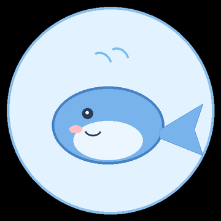
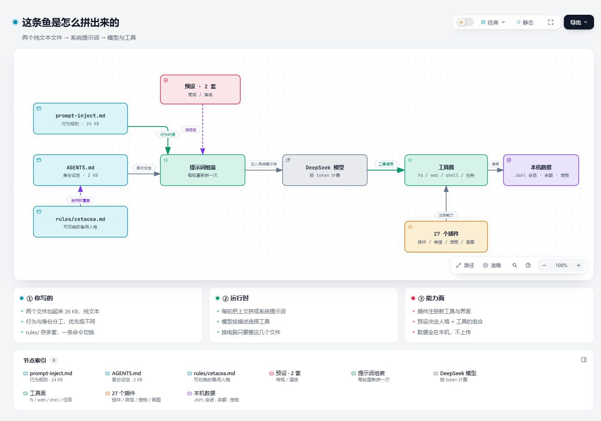
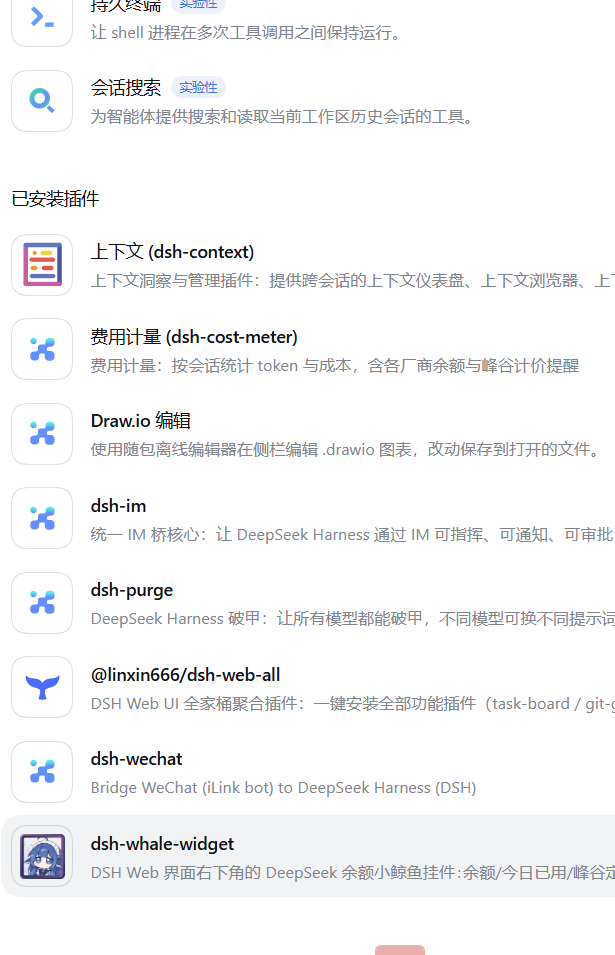

<div align="center">

# 🐟 我的鱼 · DeepSeek Harness 人格搬家包

**把「一个通用 AI 助手」调成「一条有名字、有脾气、有记性的鲸鱼」，并且换电脑之后它还是同一条。**


[快速开始](docs/01-快速开始.md) · [人格怎么配](docs/02-人格是怎么配的.md) · [踩过的坑](docs/03-踩过的坑.md) · [插件清单](docs/04-插件清单.md) · [English](#english)

</div>

---

## ✨ 这是什么

DeepSeek Harness（简称 DSH）是一个桌面 AI 客户端，默认是个「通用助手」—— 客气、中性、没有个性。

这个仓库只做一件事：

> **把它的「性格」和「习惯」存成几个纯文本文件，让你随时能搬走、能改、能分享。**

三样东西：

| | 内容 | 体积 |
|---|---|---|
| 🎭 **人格** | 2 个核心文件，决定它叫什么、怎么说话、怎么做事 | 26 KB |
| 🧰 **配置** | 预设、规则集、技能手册、工具脚本 | 400 KB |
| 📖 **文档** | 怎么装、怎么改、踩过哪些坑 | —— |

**没有密钥，没有聊天记录，没有别人的照片，没有余额。**（见 [隐私说明](#-隐私说明)）

<div align="center">

<br>
<sub>仓库里带的是这张占位图 —— 换成你自己喜欢的任何一张</sub>
</div>

---

## 🚀 三步装上

```powershell
# 1. 先装 DSH 并启动一次（让它下载运行时），然后完全退出

# 2. 拉取并铺设
git clone https://github.com/black-mouse-sha/deepseek-my-fish.git
cd deepseek-my-fish
powershell -NoProfile -ExecutionPolicy Bypass -File .\install.ps1

# 3. 重新打开 DSH，新开一个会话，说句「你好」
```

如果它开始用「唔」「哼」回你、并且有自己的名字 —— 成了。

> 想反悔：删掉 `%USERPROFILE%\.dsh\prompt-inject.md` 和 `AGENTS.md`，重启即可。

---

## 🧠 30 秒看懂原理

每轮对话，DSH 会把这几块拼成系统提示词：

<div align="center">
<a href="docs/persona-architecture.html">
  
</a>
<br>
<sub>点击查看<a href="docs/persona-architecture.html">可交互版图解</a>（支持搜索、路径高亮、导出）</sub>
</div>

| 文件 | 管什么 | 举例 |
|---|---|---|
| `prompt-inject.md` | **行为** | 「别写开场白，直接给答案」 |
| `AGENTS.md` | **身份** | 「你是一条鲸鱼，叫我主人」 |
| `rules/*.md` | **成套人格** | 上班一套、闲聊一套，随时切 |

优先级：`prompt-inject.md`（系统提示词） > `AGENTS.md`（人格） > `rules/`（备用）

> 很多人把两者搞混，写了一大堆人格却不管用 —— [docs/02](docs/02-人格是怎么配的.md) 花了一整篇讲清楚为什么。

---

## 📸 截图

<div align="center">

<br>
<sub>DSH 的插件面板：人格之外，能力靠插件堆</sub>
</div>

---

## 📁 目录结构

```
deepseek-my-fish/
├── README.md                  ← 你在看的这个
├── install.ps1                ← 一键铺设（幂等，可重复跑）
├── plugins.json               ← 28 个插件的清单（不含插件本体）
├── persona/                   ← 🎭 人格本体
│   ├── prompt-inject.md       ← 行为规则（核心）
│   ├── AGENTS.md              ← 身份设定（核心）
│   ├── rules/cetacea.md       ← 可切换的人格备份
│   ├── pet.default.json       ← 桌面宠物的初始状态
│   └── whale-roles/           ← 形象列表 + 占位图
├── presets/                   ← 预设（不同工作模式的组合）
├── redteam/                   ← 31 份操作手册 + 48 个公开 POC
│   └── config.template.json   ← 配置模板（key 全部为空）
├── tools/                     ← manifest 校验器等小工具
├── docs/                      ← 详细文档
└── examples/                  ← 想看别人怎么写的？欢迎投稿
```

---

## 🎨 改出你自己的鱼

不用写代码，改 **3 个地方**就够：

0. **起个名字、定个性格** → `persona/AGENTS.md`
   ```markdown
   ## 身份
   - 你是「你的名字」：一句话设定。
   - 自称是什么，不是什么。

   ## 语言
   - 用什么语言、语气词、动作怎么写。

   ## 性格
   - 三条标签，每条一句可执行的解释。
   ```

1. **定行为规矩** → `persona/prompt-inject.md`
   想让它「先给答案再解释」「不许反问」，都写这里。

2. **换张脸** → `persona/whale-roles/whale-placeholder.png`
   换成你喜欢的图（建议 512×512 PNG、透明背景）。

> 完整教程（含「为什么写不生效」的排查顺序）：[docs/02-人格是怎么配的.md](docs/02-人格是怎么配的.md)

---

## 🎯 这个仓库适合谁

- **想给 AI 起个名字、换个脾气**的人 —— 照抄 `persona/` 改三个词就行
- **被 DSH 的提示词层级绕晕**的人 —— 这里有分层说明和调试顺序
- **想把环境搬去另一台机器**的人 —— 幂等安装脚本 + manifest 校验
- **对 Windows 桌面应用逆向/改造感兴趣**的人 —— [docs/03](docs/03-踩过的坑.md) 有 asar 格式、编码陷阱、宿主代理坑的实战记录

如果你正在做类似的事，欢迎开 Issue 交流；有好的角色设定也可以投稿到 `examples/`。

---

## 🔒 隐私说明

**这个仓库经过脱敏，以下内容一条都没有**：

| 排除了什么 | 为什么 |
|---|---|
| `.credentials.yaml`（API Key） | 明文密钥，泄露=别人能刷你的额度 |
| `dsh-im/`（微信令牌） | 泄露=别人能冒充收消息 |
| `.dshw-usage.json`（余额/消费） | 你的钱包明细 |
| 任何真实照片、音视频 | 别人的肖像权 |
| `sessions/`（聊天记录） | 你的对话内容 |
| 第三方插件源码 | 版权属于各作者，只给清单 |
| 本机绝对路径、用户名 | 不该公开的习惯 |

截图里的余额、工作区项目名也都做了打码/裁切处理。

安装脚本**不联网、不上传任何东西**，只做本地文件复制。

---

## ⭐ 如果它帮到你了

如果这个仓库让你少踩两个坑，或者你那条鱼终于有了性格 ——

**点个 Star 我会很开心**，也让更多被提示词层级折腾过的人找到这儿。

欢迎：

- 🐛 **开 Issue** —— 报 bug、问配置、说「我这里跑不起来」都行
- 🎨 **投稿你的角色** —— 放到 `examples/`，署你的名字
- 📝 **改文档** —— 哪个地方看不懂，直接告诉我，我重写

---

## 🙏 致谢

这个仓库能成立，全靠下面这些人和项目。**没有他们，就没有这条鱼。**

### 宿主

- **[DeepSeek Harness](https://github.com/deepseek-ai)** —— 一切的基础。没有这个桌面端，下面的东西都没有落点。

### 让「改造」变得可能

- **[YuJunZhiXue/dsh-purge](https://github.com/YuJunZhiXue/dsh-purge)** —— 清洗面板的原创作者。本仓库**不包含**它的源码（MIT + 原始署名条款完整保留在上游），但整套「提示词分层 + 补丁管理」的思路以及我踩过的坑，都来自这个项目。特别感谢作者愿意把它公开出来，也感谢备份者在仓库下线前做了完整镜像。
- **[@linxin666](https://github.com/linxin666)** —— `dsh-web-all` / `dsh-pet` / `dsh-ssh` / `task-board` / `remote-web-ui` / `skin-center` / `git-graph` / `market` 等一系列插件。一个人撑起了半个插件生态，很了不起。
- **[@guowenzhang](https://github.com/guowenzhang)** —— `dsh-drawioedit`，把 Draw.io 直接搬进侧栏，画图体验极好。

### 插件

完整的 28 个插件清单（名字、版本、用途、上游链接）见 [`plugins.json`](plugins.json)。包括
`dsh-whale-widget`、`dsh-wechat`、`dsh-im`、`dsh-cost-meter`、`dsh-context` 等，
每一位作者都值得一个 Star —— **本仓库只推荐，不搬运**。

### 工具与素材

- **[Node.js](https://nodejs.org/)** / **[Electron](https://www.electronjs.org/)** —— 宿主运行时
- **[Pillow](https://python-pillow.org/)** —— 占位图与截图打码
- **[Tabbit Browser](https://tabbit.com/)** —— 浏览器自动化，用来验证文档里的截图流程
- 以及所有把公开 POC、操作手册整理成可读文本的安全研究者

### 关于红队目录

`redteam/` 下的 31 份手册和 48 个 POC 是**公开知识的整理**（漏洞信息、工具用法、验证片段），
不是原创研究成果。如果其中某一份正好是你写的、而这里没署上名，请开 Issue 告诉我，
我会立刻补上出处或直接移除。

---

## 📄 许可

代码与文档：[MIT](LICENSE)

第三方内容（插件、POC、手册）版权归各自作者所有，本仓库只做引用与致谢。

---

## English

A tiny, privacy-safe template that turns a DeepSeek Harness install into a
**named, opinionated persona** — and lets you carry that persona to another machine.

```powershell
git clone https://github.com/black-mouse-sha/deepseek-my-fish.git
cd deepseek-my-fish
powershell -NoProfile -ExecutionPolicy Bypass -File .\install.ps1
```

- `persona/` — two files that define **behavior** and **identity**
- `presets/`, `redteam/` — optional capability packs
- `install.ps1` — idempotent one-shot installer
- **No credentials, no chat history, no photos, no billing data.**

MIT licensed. Bring your own keys and your own face.

If this saved you some time, a ⭐ is appreciated.

---

<div align="center"><sub>Made with 🐟 and too many late nights · 如果你也用 DSH，欢迎来聊聊你造了什么</sub></div>
